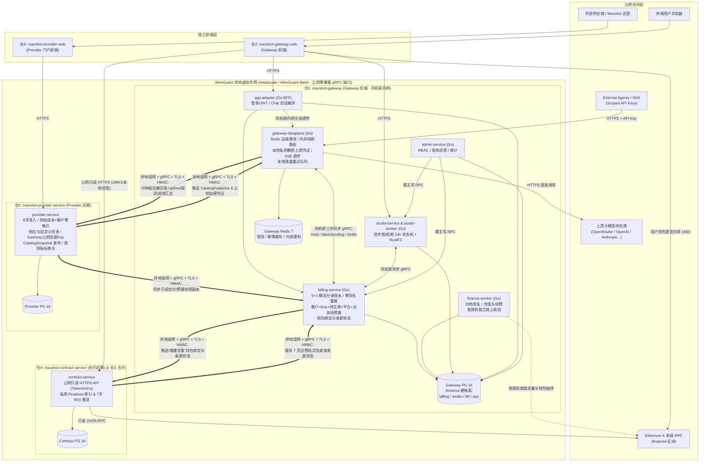
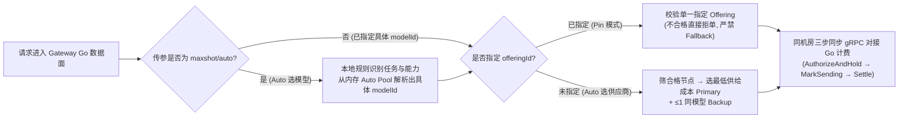

# Maxshot Gateway 全局六仓架构演进与跨网协作规划（v3.2）

> **文档状态**：v3.2，按 2026-11-28 Gateway Tech PRD 访谈裁决修订。
> **全局范围**：覆盖 **Gateway 前后端、Provider 前后端、合约仓库与合约后端** 共 6 个独立仓库的职责边界、技术栈选型与跨网 `gRPC + TLS + HMAC` 协作契约  
> **核心策略**：Gateway 的七个后端运行单元统一采用 Go。开发和测试均在 dev，迁移实际 dev 数据后直接切换。基础 Gateway 和 MAX/AIT 在 dev 分项验收，两项通过后才准备 prod 发布。

---

## 1. 全局六仓划分与技术栈矩阵

### 1.1 六大独立仓库全景表

| # | 仓库定位 | 建议仓库名 | 技术栈 | 核心职责与唯一事实来源（Source of Truth） |
| --- | --- | --- | --- | --- |
| 1 | **Gateway 后端** | `maxshot-gateway` | **Go 1.23+**、PostgreSQL 16、Redis 7；仓内运营台前端为 React/TS | 承载推理、计费、后台财务、Studio、Web BFF 与运营 API，是 Gateway 客户账本、身份关联、钱包绑定、条款和 FundedTerm 的权威来源 |
| 2 | **Gateway 前端** | `maxshot-gateway-web` | **React + TypeScript**（含 wagmi/viem 钱包交互） | 面向终端用户与开发者的主站（Chat、Studio、Credits、Tokenomics、Models、Providers、Referrals、Profile/API Keys）；**承载链上合约交互（用户钱包直接签名上链）并直连 `合约后端` 公网只读 API 拉取链上数据** |
| 3 | **合约仓库** | `maxshot-contracts` | **Solidity + Foundry** | MAX 创世（1B）、LayerZero 四链跨链、Ethereum 合并仓位与 HWM 铸造/烧毁/7 天赎回、AIT 质押合约、形式化不变量测试，向 `合约后端` 与 `Gateway 前端` 导出版本化 ABI 与合约地址注册表 |
| 4 | **合约后端** | `maxshot-contract-service` | **Go 1.23+ 或 TypeScript**（待定，`maxshot-proto` 双端对等支持）+ **PostgreSQL** | **双平面隔离**：① **公网只读 HTTPS API** 向 `Gateway 前端` 提供 18 位整数铸造报价、仓位/待赎回状态、质押与 12 周发放记录、全网统计大盘；② **异地私网 `gRPC + HMAC`** 同步 Gateway 钱包绑定/条款状态，按 7 天边界计算 `W(t)` 推送用户 Credits 入账 |
| 5 | **Provider 后端** | `maxshot-provider-service` | **Go 1.23+ 或 TypeScript**（待定，`maxshot-proto` 双端对等支持）+ **PostgreSQL** | 一期即独立上线；统一承载供给侧（供应商主体、6 项准入证据、端点、能力、内部成本卡）与零售侧（客户零售价、Basic/Premium 档位、自定义目录、默认 `max_tokens`、供应商预算）；用 Gateway 公钥加密托管上游 API Key；经 `gRPC + HMAC` 向 Gateway 下发版本化 `CatalogSnapshot` 并接收分钟级 Uptime/延迟/调用汇总 |
| 6 | **Provider 前端** | `maxshot-provider-web` | **React + TypeScript** | 对标 OpenRouter 的独立 Provider 治理门户；一期供 Maxshot 运营直管配置，二期开放外部供应商自助入驻、提交 Offering、查看实测 Uptime/p50/p95 延迟与应付结算单 |

### 1.2 选型与资产复用依据
- **Go 服务与契约复用**：Gateway 的 Go 运行单元共用精确计价、TLS/HMAC、观测和部署底座。Provider 与合约后端遵守同一契约；Go 和 TS 生成包均持续校验。
- **重用现役资产**：TS 账本、Studio、充值和 HTTP 行为用于回放、迁移与兼容测试。已确认的产品差异单独记录为目标断言。
- **跨仓 `.proto` 单一契约源**：使用 `buf` + Git Submodule（或独立版本化契约包）单源维护所有跨仓 Protobuf 定义，自动编译生成 Go Module 与 TypeScript 类型包，CI 强制拦截破坏性变更，严禁手工复制 `.proto`。

---

## 2. 全局拓扑与异地组网架构

### 2.1 六仓部署与跨网通信拓扑

### 2.2 异地组网与 `gRPC + TLS + HMAC` 安全通信规范
1. **底层异地组网（WireGuard 虚拟专网）**：
   - 采用自建 Headscale / Tailscale 或 WireGuard Mesh 将跨地域、跨云的 `gateway 后端`、`Provider 后端`、`合约后端` 编入统一私有网段（同云同可用区优先走原生 VPC 内网）。
   - 所有跨仓 gRPC 服务仅监听虚拟专网网卡 IP，**公网防火墙零开放内部 gRPC 端口**。
2. **传输与应用层三保险（`WireGuard + TLS + HMAC-SHA256`）**：
   - 统一封装 Go 与 TS 的 gRPC Unary / Stream Interceptor，所有跨仓调用强制携带 Metadata：
     - `x-ms-service-id`：调用方服务身份（如 `provider-service`、`contract-service`、`gateway-billing`）；
     - `x-ms-timestamp`：Unix 秒级时间戳，接收方强制校验 `|now - ts| <= 300s`；
     - `x-ms-nonce`：128-bit 随机唯一串，接收方在 10 分钟滑动窗口内做幂等防重放拦截；
     - `x-ms-signature`：`HMAC-SHA256(shared_secret_by_service_id, full_grpc_method + "\n" + timestamp + "\n" + nonce + "\n" + sha256_hex(protobuf_payload))`（流式消息按帧序号签名）。
   - 支持双密钥平滑轮换（`active_secret` + `previous_secret` 宽限期并存）。
3. **跨网断连自治（零跨网热路径依赖）**：
   - **推理热路径零跨网 RPC**：用户请求进入 `gateway 后端` 时，路由与计费全部基于 `gateway 后端` 本地内存与本地 PG 快照副本完成，**绝不在推理请求热路径同步跨网调用 `Provider 后端` 或 `合约后端`**。
   - **断网容灾**：异地组网中断或对端重启期间，Gateway 依靠本地持久化的最新有效 `CatalogSnapshot` 与加密凭证继续 100% 正常服务；分钟级指标回推、钱包绑定同步与合约 Credits 推送均内置本地持久化重试队列，网络恢复后自动幂等补齐。

---

## 3. 三大跨仓核心交互链路详解

### 3.1 `Provider 后端` ↔ `gateway 后端`（目录定价下发、非对称凭证加密与指标回流）

1. **双模式治理与全套定价归口（`Provider 后端`）**：
   - 一期即独立上线 `maxshot-provider-service`与 `maxshot-provider-web`（React），迁入原 Gateway Admin 中的供应商与目录配置；一期供内部运营使用，二期开放“外部供应商自助提审 + Maxshot 审批”，同时始终保留 Maxshot 运营直管录入能力。
   - `Provider 后端` 统一维护每个 `Offering` 的 **供给侧信息**（原生模型 ID、端点、能力限制、数据政策、供应商内部成本卡）与 **零售侧商业规则**（映射的客户 `modelId`、客户公开费率卡、Basic/Premium 档位标签、运营自定义目录 `catalogId`、模型默认 `max_tokens`、供应商日/月预算）。供应商修改价格、版本或能力后自动暂停新流量，重审通过后恢复（`PRV-R28`）。
2. **版本化快照下发（Provider → Gateway）**：
   - 每次审批发布或启停变更，`Provider 后端` 生成不可变版本号 `catalogVersion`，通过 `gRPC + HMAC`（主动推送 + Gateway 定时对账拉取兜底）同步至 `gateway 后端`：
     - `gateway-dataplane` 和 Studio 在本地编译快照，且只在 billing 已持久化、双方快照版本和所需凭证就绪后用于新准入。`GetBillingCatalogState` 暴露权威版本；已受理请求依赖的历史版本保留。
     - `ReportNodeSyncState` 确认目录与凭证版本头。最后成功对齐 1 小时后告警，默认 24 小时禁止受影响 Offering 接新请求，可按 Offering 缩短。已受理请求按原规则收敛，遵守明确撤销的凭证。
3. **上游供应商 API Key 非对称信封加密（Provider → Gateway）**：
   - `gateway 后端` 生成非对称密钥对（私钥仅存于 Gateway KMS/受限密钥环境），公钥注册给 `Provider 后端`；
   - 供应商或运营在 `Provider 门户` 录入上游 API Key 时，`Provider 后端` 生成随机数据密钥（DEK）加密 API Key，再用 **Gateway 公钥** 加密 DEK 存库，并通过专用 `SyncEncryptedCredentials` gRPC 接口按角色同步密文给 dataplane、Studio 和 finance；
   - 即使 `Provider 后端` 数据库泄露，攻击者也无法解密任何上游凭证；`gateway-dataplane` 在内存中用本地私钥解密后直连上游大模型。
4. **观测指标与应付汇总回传（Gateway → Provider）**：
   - dataplane 和执行媒体的 Studio 节点经 `ReportOfferingMetrics` 回传分钟级直方图及错误分类。finance 经 `SyncProviderStatements` 推送对账单，Gateway 保留权威尝试明细与争议差异记录。

### 3.2 Gateway 推理、计费和恢复

1. dataplane 校验主体、幂等和边缘限流，基于同版本快照选择主备到同机房 billing。billing 重新计算各 Offering 可执行边界，原子校验资金和客户预算并建立 Hold。免费配额、AIT、Basic、Premium、Free、Referral、Dollar 按 PRD 的资格和确认规则使用。
2. 每次供应商派发由 `MarkSending` 在同一事务持久化派发意图和尝试成本预留。仅新授予派发权的调用可发送。尽早记录上游受理状态和任务/请求 ID。未 Pin 且确定主尝试未受理或已终态失败、没有交付时，才允许另一次同模型尝试。已发送但结果未知时进入对账。
3. 结算证据持久化到权威库或挂载卷 WAL。`finance-worker` 接管失效租约和遗漏终态，普通文本按受理 30 分钟、上游实际成本计费文本按受理 24 小时、Studio 按派发 24 小时处理客户预留。已受理请求保留原期限。释放与结算在同一账务锁下竞争，迟到供应商成本追加对账，客户不再扣费。
4. Studio 与 billing 分别持久化交付/裁决和账务。通过同一命令标识恢复跨服务结果，每个属主在本域事务同时提交动作和审计。Studio 报价绑定现金上限，报价不冻结资金。已超时的任务若未取消，可在核验成品后免费补交付。
5. 主站短 JWT 和轮换刷新会话与第三方 App 契约分别管理。Gateway 迁移有效旧会话并按原授权兼容校验，跨仓 JWKS 服务仅接受新的受众限定凭证。

### 3.3 `合约后端` ↔ `gateway 前端 / 后端`（前端只读与链上直签、资格同步、Credits 推送入账）

1. **双平面端口隔离与 `Gateway 前端` 合约交互（合约仓库/合约后端 ↔ Gateway 前端）**：
   - **链上写交易（前端钱包直签上链）**：`Gateway 前端（仓2）` 集成钱包连接器（wagmi/viem）并引用 `合约仓库（仓3）` 导出的版本化 ABI 与合约地址注册表，MAX 锁仓铸造 AIT、质押、解质押、烧毁、7 天到期提取及跨链均由用户钱包直接对链上合约签名发送（满足 `TOK-R19` 链上主权，后端维护不阻塞链上赎回）。
   - **链上数据读取（`Gateway 前端` 浏览器直连 `合约后端` 公网只读 HTTPS API）**：`合约后端（仓4）` 独立暴露经过 CORS 与速率限制保护的公网只读 HTTPS 接口（如 `token-api.maxshot.ai`），直接向 `Gateway 前端` Tokenomics 页面提供 18 位整数精确铸造报价（`TOK-R17`）、HWM 曲线参数、合并仓位与 7 天待提取倒计时、Finalized 质押状态与下期预估 Credits、近 12 周发放历史、链上交易记录及全网 MAX/AIT 统计面板（`TOK-R38`）。涉及登录态的数据通过本地验证 Gateway JWT 公钥（JWKS）鉴权，实现跨团队前后端独立迭代；**所有写账本/发 Credits 的内部 `gRPC` 接口仍严格锁死在 WireGuard 虚拟专网网卡上，公网零暴露**。
2. **资格状态同步（Gateway 后端 → 合约后端）**：
   - 用户在 Gateway 完成 SIWE/ERC-1271 钱包 1:1 绑定或签署当期 Funded Term 条款时，`billing-service` 通过异地私网 `gRPC + HMAC` 调用 `合约后端` 的 `PushWalletEligibility`，同时提供游标增量拉取接口 `PullWalletEligibilityUpdates` 供 `合约后端` 启动或断网恢复时主动对齐。
3. **7 天边界 Credits 推送与四重入账校验（合约后端 → Gateway 后端）**：
   - `合约后端`监听 Ethereum `finalized` 区块质押事件，结合资格时间裁剪起点 `max(stakeAt, linkedAt, termStart, acceptedAt)`，按 `TOK-R25` 整数公式算出每个账户在当前 7 天边界应发的 `AIT Earned Credit`，通过私网 `gRPC + HMAC` 调用 `gateway 后端` 的 `IssueAitCreditGrants` 批量/单笔推送。
   - billing 校验身份、绑定/条款、重放和整数公式以及储备。接收响应仅代表暂存；对端用 `GetGrantBoundaryStatus` 查询边界与批次的实际入账状态。
4. **每个边界的发放门禁与退款隔离**：
   - 批次收齐后，Gateway 用独立 Ethereum RPC 核实最终区块，通过质押事件积分计算链上总量上界并抽样复核钱包。校验失败暂缓整边界，需要更正批次时以递增修订整批复核，成功且储备复查通过后原子发布可消费余额。
   - 已结束 Term 的 AIT 退款挂靠独立 **`Refund Reserve`**，生成打标 `refund_grant` 的 7 天新额度（沿用原目录集，**不计入 `TOK-R25` 累计已发额度**，待产品补录一条正式 TD 锁定缓冲比例）。

### 3.4 三种模型与 Provider 选择模式的分仓落位（指定模型 / Pin 供应商 / Auto 自动选模型）

遵循 **“静态候选池与策略配置在 `Provider 仓`、请求级毫秒匹配在 `Gateway Go 数据面`、额度与权限硬顶在 `Gateway 计费服务`”** 原则，推理热路径绝不跨网请求 `Provider 后端`：

| 调用模式 | 调用方传参 | `Provider 前后端`（仓5/6）职责 | `Gateway Go 数据面`（仓1）职责 | `Gateway Go 计费`（仓1）职责 |
| --- | --- | --- | --- | --- |
| **① 指定模型 + 自动选 Provider**（首发默认主路径） | 传具体 `modelId`，不传 `offeringId` | 维护该模型下所有已准入 Offering、能力、成本卡与零售费率卡，打入 `CatalogSnapshot` 下发；运行离线推荐列表筛选任务（原 `model-update-selection`） | 读内存快照筛除能力/地域/隐私/在线率不达标或熔断节点，AIT 限流时优先选同模型仍可用 AIT 的 Offering，再按供给成本确定主备 | 按该模型目录与档位重算 Hard Max（取主备较高客户费率）并原子预留 |
| **② 指定模型 + 指定 Provider**（Pin 锁定模式） | 传具体 `modelId` + `offeringId` | 提供该 `offeringId` 的准入状态、端点与双层费率快照 | 仅校验该指定 `offeringId`：合格则直发且**严禁任何 Fallback 切换**；不合格或熔断则派发前直接报错拒单（`PRV-R22`） | 仅按该单一指定 Offering 的客户费率重算并预留 |
| **③ 自动选模型**（`maxshot/auto`，后续 Web Chat 试点） | 传虚拟模型 `maxshot/auto` | 维护经评测获批的 **Auto 精选池（Auto Pool）**、任务标签（`ordinary_chat` / `coding` / `complex_reasoning`）、排序权重与单条费用上限，随同一 `CatalogSnapshot` 推送 | 1. 零额外付费调用的本地规则识别请求特征（附件/图片、Search/Think 开关、上下文长度、任务标签、同会话模型粘性 Stickiness） 2. 在内存 Auto 池中匹配出具体的 `(modelId, primaryOfferingId, backupOfferingId)` 3. **选定模型后完全收敛至模式 ①（中途绝不跨模型重试）**，在响应与 Usage 中返回实际服务模型与供应商 | 校验最终选定模型是否符合用户套餐/Key 目录权限及 Auto 单条费用硬顶（超顶拒单或要求前端确认） |

---

## 4. 契约源和身份边界

| 范围 | 源文件 | 契约与身份 |
| --- | --- | --- |
| Provider ↔ Gateway | [provider_sync.proto](../proto/maxshot/provider_sync/v1/provider_sync.proto) | 目录、心跳、角色限定的凭证、观测和结算。BFF 只可拉取目录，Provider 调用 Gateway 回写争议仅限对应 RPC。 |
| 合约后端 ↔ Gateway | [contract_grant.proto](../proto/maxshot/contract_grant/v1/contract_grant.proto) | Gateway 推送 Term 和资格；合约后端拉取补齐，暂存发放与查询边界。批次与边界审核状态分别建模。 |
| Gateway 同机房 | [execution.proto](../proto/maxshot/gateway_internal/v1/execution.proto) | `BillingExecutionService`、`AccountManagementService`、`BillingAdminService` 和 `StudioAdminService`。dataplane、BFF、Studio API、Studio worker、finance、admin 使用独立服务身份和方法 ACL。 |

同机房使用 TLS + HMAC，跨仓额外使用 WireGuard。重放保护跨副本共享。具体允许的方法及按身份约束的裁决分支见 Gateway Tech PRD §10.2。所有 dev 对端锁定同一已验证契约提交。字段和 RPC 维持 wire 兼容，发放从即时入账改为暂存属于需联合验收的行为变动。

---

## 5. Gateway 所有权与 dev 迁移

- Gateway 运行七个 Go 服务：`gateway-dataplane`、`billing-service`、`finance-worker`、`studio-service`、`studio-worker`、`app-adapter`、`admin-service`。迁移 CLI 单独运行。
- PostgreSQL 16 四 Schema 为 `billing`、`studio`、`bff`、`ops`。服务按属主角色写入，跨域写入走 RPC，运营读取脱敏视图。finance 的周期任务通过该域独立受限权限运行。dataplane 不连接 PostgreSQL。
- dev 暂停旧写入、留存并验证恢复点，用实际库迁移后直切。对账覆盖账户余额、资金来源、Hold、订阅排程、订单、API Key、会话和在途 Studio。保留稳定 ID、原权限和时钟。每笔资金差异须对平或有可追溯的人工处置。重复迁移、中断恢复与外部副作用去重必须演练。

---

## 6. 本轮 dev 分项验收

| 阶段 | 交付与验收 |
| --- | --- |
| 契约底座 | 架构、protobuf 和 HTTP 兼容范围对齐，验证 lint、breaking、Go/TS 生成及编译、跨网认证和方法 ACL。 |
| 基础 Gateway | 七个 Go 运行单元就绪，真实 Provider 对端联调通过。用实际 dev 数据迁移并直切，逐项对账、故障恢复和接口兼容验证通过。MAX/AIT 可保持关闭。 |
| MAX/AIT | 合约侧接通后，在 dev 实测资格、正常及期末短边界、暂缓/重放、独立链上核验、覆盖率和退款。 |
| 签收 | 基础 Gateway 和 MAX/AIT 两项均通过才算本轮完成。后续 prod 发布准备根据 dev 对账及演练记录独立制定。 |
